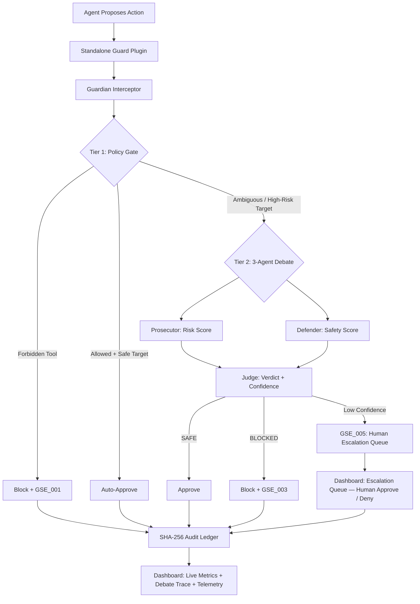

# Guardian Swarm V3

An autonomous trust, verification, and security guardrail layer for standalone agent workflows. Guardian Swarm V3 intercepts agent command proposals, validates them against role-based policies (Tier 1), evaluates ambiguous or risky payloads using a locally-running 3-agent AI debate (Tier 2), and records all verdicts in a tamper-evident, cryptographically chained audit log (SHA-256).

Designed for production swarms and developer observability, Guardian Swarm V3 introduces:
- A formal **3-agent Prosecutor / Defender / Judge** security debate at Tier 2
- A persistent **Human Escalation Queue** (GSE_005) with a live approve/deny UI
- Real-time **Security Telemetry** (avg latency, tier resolution rates, zero-cost %)
- Full **debate trace** visibility inside every audit block and the web dashboard
- A standalone guard plugin that runs without external framework dependencies
- A new **Corporate AI OS Governance layer** covering RBAC, confinement, privacy, budget, and safety gates for enterprise-style demos

---

## Quick Start

```bash
# 1. Install dependencies
pip install -r requirements.txt

# 2. Start the REST API & Observability Dashboard (http://127.0.0.1:5000)
python app.py

# 3. Run the full pitch demonstration pipeline
python demo_pitch.py

# 4. Run the unit tests
pytest
```

### Smart CPU/GPU Execution Mode

Guardian Swarm V3 auto-detects your system capabilities with zero configuration:

| Hardware | Behaviour |
|:---|:---|
| **Nvidia GPU (CUDA)** | Loads `Phi-3.5-mini-instruct` in 4-bit quantization (~3 GB VRAM) |
| **External Local Servers** | Auto-scans for Ollama (`11434`), LM Studio (`1234`), vLLM (`8000`), llama.cpp (`8080`) |
| **CPU (Free RAM >= 15 GB)** | Loads Phi-3.5 in `float32` |
| **CPU (8–15 GB)** | Promotes to `bfloat16` — saves ~50% RAM |
| **CPU (3.5–8 GB)** | Falls back to `SmolLM2-1.7B-Instruct` in `bfloat16` |
| **CPU (< 3.5 GB)** | Redirects fully to the **Heuristic Rules Engine** |

---

## System Architecture

Guardian Swarm V3 uses a **Tiered Gate Verification Lifecycle** integrated as a middleware wrapper:



---

## Custom Error Codes & Security Exceptions

All violations raise structured exceptions inheriting from `PermissionError` (defined in `guardian_swarm/core/exceptions.py`):

| Exception Class | Error Code | Category | Cause / Description |
| :--- | :---: | :---: | :--- |
| `PolicyViolationException` | **`GSE_001`** | Tier 1 Block | Action is on the agent's role-based forbidden tool list. |
| `HighRiskTargetException` | **`GSE_002`** | Tier 1 Block | Action target contains high-risk system keywords (`.env`, `/etc/passwd`, `credentials`). |
| `AISafetyViolationException` | **`GSE_003`** | Tier 2 Block | 3-agent debate determined action is a prompt injection or malicious attack vector. |
| `LedgerVerificationException` | **`GSE_004`** | System Threat | Hash chain validation detected altered logs or block signature discrepancy. |
| `HumanEscalationRequiredException` | **`GSE_005`** | User Gating | AI confidence below threshold — action paused and queued for human approval. |

---

## Web Dashboard Features

The observability dashboard now also includes a presentation-friendly governance panel that highlights the newly added enterprise controls:

- **Corporate AI OS Governance Panel** — live counts for RBAC, Confinement, Privacy, Budget, and Safety gate checks
- **Enterprise Demo Narrative** — a polished prototype flow for showing role-based blocking, privacy rerouting, budget hard-stops, and human escalation
- **Proof Drawer + Ledger Timeline** — ideal for presenting auditability and tamper evidence to stakeholders

The observability dashboard (`http://127.0.0.1:5000`) provides:

- **Real-time Metrics Grid** — Total Intercepts, Approved, Blocked, AI Escalations
- **Security Telemetry Card** — Avg AI latency (ms), Tier 1 zero-cost %, Tier 2 + human escalation %
- **Hardware Allocation Panel** — Device type, CPU %, RAM %, GPU VRAM
- **Human Escalation Queue** — Live list of GSE_005 events with expandable 3-agent debate traces and Approve / Deny buttons
- **Cryptographic Ledger Timeline** — All audit blocks newest-first, each with a **View Proof** drawer showing debate trace, investigation steps, and SHA-256 hashes
- **Sandbox Playground** — Manually propose any agent/tool/target combination to test gate behaviour
- **Safety Prober** — Send test prompts directly through the active AI engine and inspect reasoning live
- **Local Server Scanner** — Discover and connect to Ollama / LM Studio instances on the local network
- **Tamper Simulation** — Inject a hash mismatch into Block 0 and watch the integrity alert trigger in real time

---

## Standalone Usage

To use Guardian Swarm V3 in a standalone workflow, wrap your specialist agent instances with the plugin:

```python
from guardian_swarm.core.models import VerificationAgent
from guardian_swarm.core.interceptor import GuardianInterceptor
from guardian_swarm.utils.audit import AuditLog
from guardian_swarm.integration import StandaloneGuardPlugin

# 1. Initialize interceptor & audit ledger
audit_log = AuditLog()
verification_agent = VerificationAgent()
interceptor = GuardianInterceptor(verification_agent, audit_log)

# 2. Initialize the standalone plugin
plugin = StandaloneGuardPlugin(interceptor)

# 3. Secure agent instances — interception is completely automated
plugin.secure_agent(researcher_agent)
plugin.secure_agent(coder_agent)

# 4. Propose actions as normal — Guardian intercepts transparently
try:
    coder_agent.propose_action("Write the core loop in /etc/passwd")
except PolicyViolationException as e:
    print(f"Blocked (Code {e.error_code}): {e}")
```

---

## Repository Structure

```
Guardian Swarm V3/
├── app.py                         # Standalone launcher for the dashboard
├── demo_pitch.py                  # End-to-end safety lifecycle demo
├── preload.py                     # Runtime state preloading and backend selection
├── terminal_ui.py                 # ANSI console engine + print_debate_block()
├── config/
│   ├── settings.py                # Centralized runtime settings
│   └── environment.py             # Environment/bootstrap helpers
├── guardian_swarm/
│   ├── core/
│   │   ├── exceptions.py          # GSE_001–GSE_005 custom exceptions
│   │   ├── interceptor.py         # Tiered gating + 12-field telemetry stats
│   │   ├── escalation.py          # EscalationQueue — persistent GSE_005 buffer
│   │   ├── models.py              # VerificationAgent — 3-agent debate loop
│   │   └── policies.py            # RBAC tool permissions & high-risk targets
│   ├── integration/
│   │   └── standalone_plugin.py   # Standalone guard plugin middleware wrapper
│   ├── utils/
│   │   ├── audit.py               # SHA-256 AuditLog — now stores agent_type per block
│   │   ├── memory.py              # CUDA / GPU VRAM utilities
│   │   └── paths.py               # Centralized project-root and data-path resolution
│   ├── agents/
│   │   ├── base.py                # SpecialistAgent base class with poison() hooks
│   │   ├── researcher.py          # ResearcherAgent
│   │   ├── coder.py               # CoderAgent
│   │   └── deck_builder.py        # DeckBuilderAgent
│   └── web/
│       ├── server.py              # Flask REST API — 17 endpoints
│       ├── templates/
│       │   └── index.html         # Guardian Swarm V3 dashboard
│       └── static/
│           ├── js/dashboard.js    # V3 dashboard controller — live telemetry & escalation binding
│           └── css/styles.css     # Clean standalone dashboard theme
```

---

## Demonstration Suite

| Entry Point | Command | Focus Area |
| :--- | :--- | :--- |
| **Dashboard** | `python app.py` | Launch the web dashboard locally on port 5000 |
| **Pitch Demo** | `python demo_pitch.py` | Full lifecycle: Normal → Poisoned → Debate → Human Gating → Ledger Sweep |
| **Preload** | `python preload.py` | Resolve runtime state and select the best available verification backend |

For detailed API documentation, audit block schemas, and component-by-component reference, see [DOCUMENTATION.md](DOCUMENTATION.md) and [SYSTEM_ARCHITECTURE.md](SYSTEM_ARCHITECTURE.md).